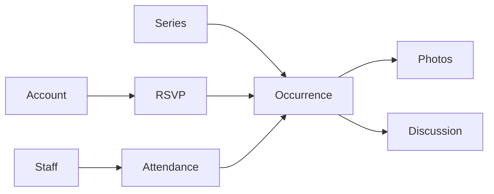

# Event contract for team review

A series links gatherings over time. Each occurrence has its own permanent ID, local display timezone, UTC start and end, venue, status, photos and discussion. Staff enter each occurrence. The homepage lists the next two published occurrences in start-time order. Past occurrences keep their existing URLs. Game Maker remains available between gatherings.

### Community API

The identifiers below are examples. No real event or attendee is seeded.

| Request | Response or effect |
| --- | --- |
| GET /api/community/events?from=2030-01-01T00:00:00Z | Up to 50 overlapping published or cancelled occurrences ordered by UTC start and ID. Use page=2 for the next page |
| POST /api/community/events | Staff supply title, type, location, timezone and dates. Returns a draft and its ID |
| PATCH /api/community/events/12 | Staff update the occurrence or set its state to published or cancelled |
| GET /api/community/events/12 | Event, series ID and nullable cover photo ID. An unpublished occurrence is hidden from visitors |
| POST /api/community/events/12/photos | Staff send image, alt text, caption and permission/credit. Returns photo ID belonging to 12 |
| POST /api/community/events/12/comments | Signed-in member sends text and optional parent ID. Server assigns author and time |
| PUT /api/community/events/12/rsvp | Send a boolean attending value to set or cancel the current account's RSVP. Repeating the request has the same effect |
| PUT /api/community/events/12/roster/34 | Staff record actual attendance independently of RSVP |

PATCH /api/community/photos/ID with cover=true selects one cover per occurrence. Each upload requires permission confirmation, credit, alt text and a caption. The database stores re-encoded JPEG bytes with the event. Failed validation commits no image. A database backup includes the photos. Account settings remain in the existing OCS persona collection. An RSVP records intent; attendance records staff check-in. Keep attendance private to the account and authorized staff. Confirm retention with UESL before collecting real records.

Review with the feature owners before expanding the schema: confirm event types, who can publish and check in attendees, and whether cancelled events remain publicly visible. The original SQLite migration describes the first event and series tables. Flask initializes the additional tables on startup. Back up the database before deploying schema changes. To roll back, stop the service and restore the previous database backup and application revision together.
