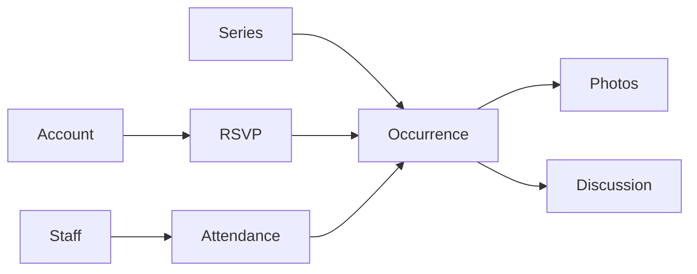

# Event contract for team review

A series links gatherings over time. Each occurrence has its own permanent ID, local display timezone, UTC start and end, venue, status, photos and discussion. Staff enter each occurrence. The homepage lists the next two published occurrences in start-time order. Past occurrences keep their existing URLs. Game Maker remains available between gatherings.

### Proposed API examples

The identifiers below are examples. No real event or attendee is seeded.

| Request | Response or effect |
| --- | --- |
| GET /api/events?limit=2&upcoming=true | List of published occurrences ordered by UTC start and ID |
| POST /api/events | Staff supply title, type, location, timezone and dates. Returns a draft and its ID |
| PATCH /api/events/12 | Staff update the occurrence or set its state to published or cancelled |
| GET /api/events/12 | Event, series ID and nullable cover photo ID. An unpublished occurrence is hidden from visitors |
| POST /api/events/12/photos | Staff send image, alt text, caption and permission/credit. Returns photo ID belonging to 12 |
| POST /api/events/12/comments | Signed-in member sends text and optional parent ID. Server assigns author and time |
| PUT or DELETE /api/events/12/rsvp | Set or cancel the current account's RSVP. Repeating the request has the same effect |
| PUT /api/events/12/attendance/34 | Staff record actual attendance independently of RSVP |

Store one cover selection per occurrence when the photo schema lands. Account settings remain in the existing OCS persona collection. An RSVP records intent; attendance records staff check-in. Keep attendance private to the account and authorized staff. Confirm retention with UESL before collecting real records.

Review with the feature owners before expanding the schema: confirm event types, who can publish and check in attendees, and whether cancelled events remain publicly visible. The SQLite migration is an isolated proposal; the test applies and reverses it only in memory.

## Event albums and discussion

`api/community_events.py` uses the same `uesl_event` columns as `001`; the
application’s normal SQLAlchemy startup creates missing tables. It adds
`uesl_event_details` (description and one selected cover), `uesl_event_photo`,
and `uesl_event_comment`. There are no production seed events. A cancelled
occurrence stays publicly readable but is excluded from the upcoming feed.

The `/api/events` endpoints reuse the normal OCS session and configured staff
roles. The staff endpoints list drafts (`GET /manage`), accept multipart photo
uploads (`POST /<id>/photos`), and save a complete order and cover together
(`PUT /<id>/photos`). Private permission references and draft images are
available only to staff. The frontend uses `X-Origin: client` and the existing
allowed-origin policy for mutations. See the route tests for examples.

The app decodes still JPEG, PNG and WebP images (up to 4 MiB and 24 megapixels),
strips metadata, and transactionally stores normalized JPEG display and
thumbnail bytes in the same database as the album. The original names and
files are never retained. Invalid uploads leave no files or rows. Removing an
image deletes its bytes and clears its cover selection if needed. Back up the
configured database, including BLOBs (with the existing persistent `instance`
volume for SQLite), and include it in restore tests. Backups may temporarily
retain removed content; follow UESL’s agreed retention and access policy.

Event discussion reads are paginated (`after=<last ID>`), and replies are
limited to one level. Writes derive the author from the active account.
Removal clears the text but keeps a tombstone so replies stay in context.
Only the author may edit; both authors and staff may remove. This is scoped
to the event and does not use chat or a WebSocket.
