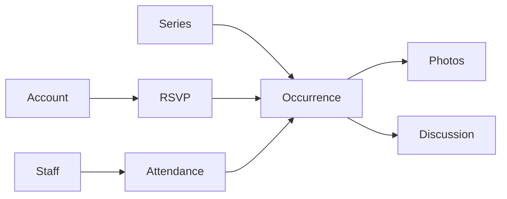

# Event contract for team review

A series links gatherings over time. Each occurrence has its own permanent ID, local display timezone, UTC start and end, venue, status, photos and discussion. Staff enter each occurrence. The homepage lists the next two published occurrences in start-time order. Past occurrences keep their existing URLs. Game Maker remains available between gatherings.

### Proposed API examples

The identifiers below are examples. No real event or attendee is seeded.

| Request | Response or effect |
| --- | --- |
| GET /api/events?limit=2&upcoming=true | List of published occurrences ordered by UTC start and ID |
| POST /api/events | Staff supply title, type, location, timezone and dates. Returns a draft and its ID |
| PATCH /api/events/12 | Staff update the occurrence or set its state to published or cancelled |
| GET /api/events/12 | Event, series ID and nullable cover photo ID. An unpublished occurrence is hidden from visitors |
| POST /api/events/12/photos | Staff send image, alt text, caption and permission/credit. Returns photo ID belonging to 12 |
| POST /api/events/12/comments | Signed-in member sends text and optional parent ID. Server assigns author and time |
| PUT or DELETE /api/events/12/rsvp | Set or cancel the current account's RSVP. Repeating the request has the same effect |
| PUT /api/events/12/attendance/34 | Staff record actual attendance independently of RSVP |

Store one cover selection per occurrence when the photo schema lands. Account settings remain in the existing OCS persona collection. An RSVP records intent; attendance records staff check-in. Keep attendance private to the account and authorized staff. Confirm retention with UESL before collecting real records.

Review with the feature owners before expanding the schema: confirm event types, who can publish and check in attendees, and whether cancelled events remain publicly visible. The SQLite migration is an isolated proposal; the test applies and reverses it only in memory.
